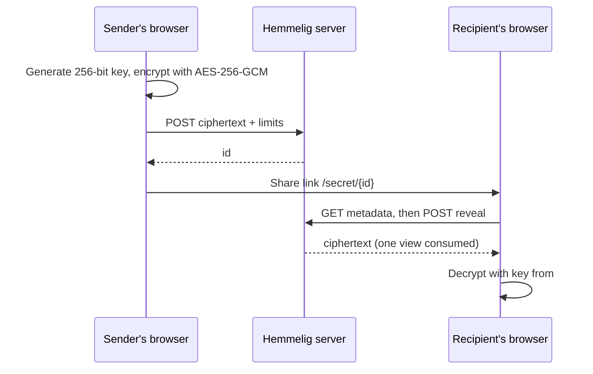

<div align="center">


# Hemmelig

[](https://github.com/janfredrik/hemmelig/actions/workflows/docker.yml)
[](https://github.com/janfredrik/hemmelig/pkgs/container/hemmelig)
[](backend/go.mod)
[](frontend/package.json)

⭐ If you find Hemmelig useful, star the repo — it helps others find it.

[Overview](#overview) • [Features](#features) • [Getting started](#getting-started) • [Configuration](#configuration) • [Development](#development) • [API](#api)

</div>

Share passwords, API keys and private notes through a link that works once and then self-destructs. The secret is encrypted in your browser before it leaves, so the server only ever stores ciphertext.

## Overview

*Hemmelig* is Norwegian for "secret". It is a small, self-hosted, zero-knowledge secret-sharing app: a single Go binary with the React frontend embedded, backed by SQLite and shipped as a ~15 MB Docker image. It was built to run comfortably on a home server such as Unraid, but works anywhere Docker does.



1. You paste a secret and choose how long it lives and how many times it can be opened.
2. Your browser generates a fresh 256-bit key and encrypts the secret with **AES-256-GCM** using the Web Crypto API.
3. Only the ciphertext is uploaded. The key is placed in the link **after the `#`**, a part of the URL browsers never send to the server.
4. The recipient opens the link, sees how many views are left, and unlocks it. Decryption happens in their browser.
5. After the last view, or when time runs out, the secret is deleted. The sender can also burn it right away.

## Features

- **Zero-knowledge** — encryption and decryption happen client-side; the server cannot read what it stores.
- **Self-destructing** — expiry from 1 hour to 30 days, and 1–100 views before deletion. Expired secrets are purged hourly.
- **Optional passphrase** — bcrypt-hashed on the server and checked before the ciphertext is released.
- **Burn on demand** — the sender can delete a secret immediately after creating it.
- **No tracking** — no accounts, no analytics, self-hosted fonts and zero third-party requests.
- **Bilingual** — English and Norwegian (bokmål), with light and dark themes.
- **Lightweight** — one static binary, SQLite storage, tiny memory footprint.

> [!TIP]
> When you use a passphrase, send it through a different channel than the link. Anyone holding both can open the secret.

## Getting started

### Run with Docker

A prebuilt `linux/amd64` image is published to the GitHub Container Registry on every push to `main`:

```bash
docker run -d --name hemmelig -p 3000:3000 -v hemmelig_data:/data ghcr.io/janfredrik/hemmelig:latest
```

Then open <http://localhost:3000>.

### Build with Docker Compose

To build the image from source instead, clone the repository and run:

```bash
docker compose up -d
```

The multi-stage [Dockerfile](Dockerfile) builds the frontend and backend inside Docker, so no local Node or Go installation is needed.

### Unraid

Add a container using `ghcr.io/janfredrik/hemmelig:latest`, map port `3000`, and map a path such as `/mnt/user/appdata/hemmelig` to `/data`.

> [!IMPORTANT]
> Browsers only allow Web Crypto on secure pages. Outside `localhost`, serve Hemmelig over **HTTPS**, for example behind a reverse proxy such as Nginx Proxy Manager, Caddy or Traefik. Over plain HTTP on a LAN address, the app explains this instead of creating secrets.

## Configuration

| Variable  | Default             | Description                 |
|-----------|---------------------|-----------------------------|
| `PORT`    | `3000`              | Port the server listens on  |
| `DB_PATH` | `/data/hemmelig.db` | Location of the SQLite file |
| `TZ`      | —                   | Optional timezone for logs  |

> [!NOTE]
> Secrets are stored in SQLite at `DB_PATH`. Mount `/data` as a volume so they survive container restarts.

## Development

**Requirements:** [Node.js](https://nodejs.org) 20+ and [Go](https://go.dev) 1.23+.

Start the backend API on port 3000:

```bash
cd backend
DB_PATH=./hemmelig.db go run .
```

In another terminal, start the Vite dev server, which proxies `/api` to the backend:

```bash
cd frontend
npm install
npm run dev
```

### Project structure

```
hemmelig/
├── backend/            # Go server: API, SQLite, embedded static files
│   └── main.go
├── frontend/           # React + Vite + Tailwind app
│   └── src/
│       ├── crypto.ts   # AES-256-GCM helpers (Web Crypto)
│       ├── api.ts      # Typed API client
│       ├── i18n.tsx    # English / Norwegian strings
│       └── pages/      # Home, SecretCreated, ViewSecret
├── Dockerfile          # Multi-stage build → Alpine runtime
└── docker-compose.yml
```

### Tech stack

- **Frontend:** React 18, React Router, Vite, TypeScript, Tailwind CSS. Fonts (Schibsted Grotesk, Azeret Mono) are self-hosted.
- **Backend:** Go with [chi](https://github.com/go-chi/chi) and [modernc.org/sqlite](https://pkg.go.dev/modernc.org/sqlite) (pure Go, no CGO). The built frontend is embedded in the binary.
- **Image:** multi-stage Docker build on Alpine, published by [GitHub Actions](.github/workflows/docker.yml).

## API

All endpoints live under `/api/v1`. The server only ever receives and returns ciphertext.

| Method   | Endpoint                | Description                                                    |
|----------|-------------------------|----------------------------------------------------------------|
| `POST`   | `/secrets`              | Store ciphertext; returns an `id`                              |
| `GET`    | `/secrets/{id}`         | Metadata: views left, expiry, whether a passphrase is required |
| `POST`   | `/secrets/{id}/reveal`  | Returns the ciphertext and consumes one view                   |
| `DELETE` | `/secrets/{id}`         | Burn a secret immediately                                      |

<details>
<summary>Create request body</summary>

```json
{
  "encryptedData": "<base64 ciphertext>",
  "expiresIn": 259200,
  "maxViews": 1,
  "isPasswordProtected": false,
  "password": ""
}
```

`expiresIn` is in seconds and clamped to 1 hour – 30 days; `maxViews` is clamped to 1–100.

</details>

## Project docs

- [PRODUCT.md](PRODUCT.md) — who Hemmelig is for, its principles and constraints.
- [DESIGN.md](DESIGN.md) — the design system: colors, type, components and motion.
